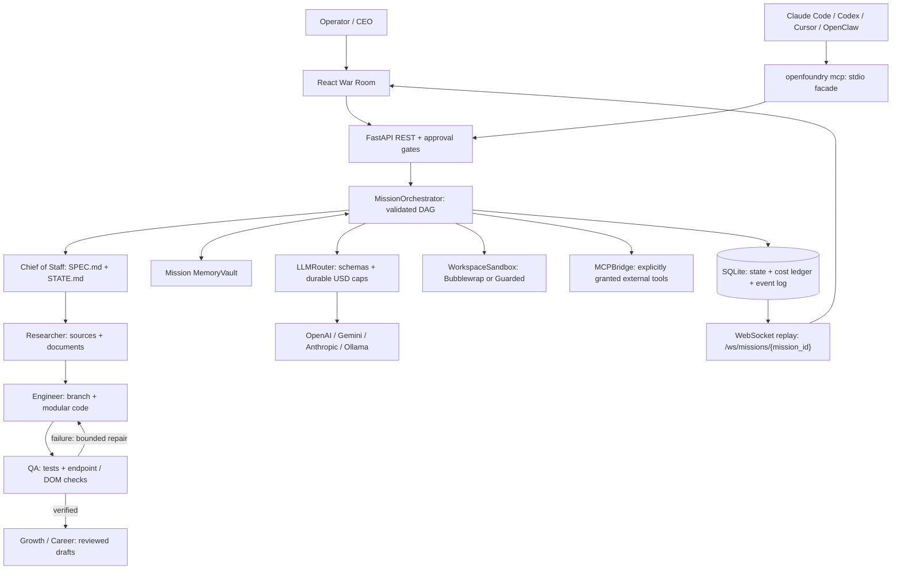

# OpenFoundry

[](https://github.com/MrMha/openfoundry/actions/workflows/ci-backend.yml)
[](https://github.com/MrMha/openfoundry/actions/workflows/ci-frontend.yml)
[](CONTRIBUTING.md#validation)
[](LICENSE)

**If an AI agent is a freelancer, OpenFoundry is your autonomous software & research company—with a built-in QA department that tests and self-heals its own code.**

[](docs/assets/war-room-demo.gif)

[](docs/assets/war-room-hero.png)

Give it a goal. Watch five departments research, plan, build, catch a defect, repair it, and prepare launch drafts in a live War Room. Review the specification before Engineering runs.

[Try the demo](#60-second-quickstart-zero-api-key-needed) · [Add a department](#build-your-own-department-in-20-lines) · [25 contributor tickets](docs/GOOD_FIRST_ISSUES.md) · [MCP setup](docs/mcp.md) · [Roadmap](ROADMAP_SPECS.md)

## 60-Second Quickstart (Zero API Key Needed)

The demo needs **no OpenAI, Gemini or Anthropic key, no Ollama server, and no paid calls**. After dependencies are installed, starting and approving it takes about a minute; the first dependency install or Docker build can take longer.

### Local: Python + Node

Prerequisites: Python 3.11+, [uv](https://docs.astral.sh/uv/getting-started/installation/), Node 22.12+ (Node 22 LTS recommended), npm and Git. Run these from a shell:

```bash
git clone https://github.com/MrMha/openfoundry.git
cd openfoundry
uv sync --frozen --extra dev
(cd frontend && npm ci && npm run build)
uv run --frozen openfoundry
```

Open **http://127.0.0.1:8000**. FastAPI serves the built UI and API together; restart the server if you build the UI after starting it. Loopback access needs no operator token unless you set `OPENFOUNDRY_API_TOKEN`.

### Docker Compose: one unified service

From the cloned repository, with Docker Engine/Desktop and Compose v2 installed:

```bash
export OPENFOUNDRY_API_TOKEN="$(openssl rand -hex 32)"
docker compose up --build
```

Open **http://127.0.0.1:8000**, choose **Connect backend**, enter the operator token from your shell, and connect. To display your generated local operator token, run `printf '%s\n' "$OPENFOUNDRY_API_TOKEN"`; keep it private. This token protects OpenFoundry; it is separate from provider API keys. `openssl` is needed only to generate that random token; an existing strong, URL-safe operator token also works.

Compose publishes port 8000 on host loopback, runs as UID 10001, checks `/health`, and keeps SQLite/shared memory in `foundry_data` and generated files in `workspaces`. `docker compose down` preserves these volumes; adding `--volumes` deletes them. No provider key is required for the demo. See [deployment details](docs/BACKEND_GUIDE.md) for sandbox and data boundaries.

### Run the real self-healing mission

1. Click **⚡ Run Self-Healing Demo (No API Key)**.
2. Review `SPEC.md` at the Engineering gate, then click **Approve & Continue**.
3. Watch **Bug Detected → Patching → Verified**. Inspect the failed check, committed patch, passing checks, and generated launch files.

The current deterministic demo completes **5 departments → 1 repair → 29 registered artifacts → $0.00 API-token cost**. Provider responses and the research source are fixtures; scheduling, SQLite, Git commits, test subprocesses, ASGI/DOM checks, artifacts and events execute for real. A fallback frame is visibly labeled as a DOM diagnostic. This is reproducible evidence of the workflow, not a claim that arbitrary apps always heal successfully.

## What your company can do

| Feature | Implemented behavior |
| --- | --- |
| **5 Autonomous Departments** | `chief_of_staff` writes `SPEC.md`/`STATE.md` and validates a DAG; `researcher` saves cited evidence; `engineer` commits modular code; `qa_self_healer` verifies and repairs; `growth_career` drafts launch or career packages. |
| **Self-Healing QA Loop** | pytest/Ruff plus ASGI/HTTP and DOM checks; structured root-cause reports; at most **3 repair rounds** after initial verification. Original acceptance tests and verification scope are protected from repair edits. |
| **Bidirectional MCP** | `openfoundry mcp` exposes mission/demo/status/department/blueprint/approval tools through the official SDK. Trusted departments can discover and invoke explicitly granted external stdio or Streamable HTTP tools. |
| **BYOK + local Ollama** | OpenAI → Gemini → Anthropic → Ollama routing, schema-validated responses, a durable usage/cost ledger and atomic budget reservations; the default mission ceiling is **$2.00**. |
| **Measured sandboxing** | `auto` probes Bubblewrap and falls back to guarded, allowlisted execution when namespaces are unavailable; `strict` fails closed. Commands have at most a 60-second timeout. |
| **Live War Room** | Typed, replayable WebSocket events; dependency graph; department thoughts; approval gates; QA evidence; code diffs; artifact inspection and cost display. |
| **Shared memory** | Per-mission persistent keyword + TF-IDF/cosine retrieval for research, document chunks, architecture decisions and bug reports. |
| **Validated blueprints** | SaaS MVP, website self-healing and career opportunity templates, loaded from JSON into the API and command bar with editable parameters and task previews. |

Live missions use your server-side provider credentials. Launch posts, career messages and outreach remain drafts; the current backend does not publish or send them.

## Architecture: a company with a feedback loop



One active coordinator owns each SQLite file. Pending tasks and approval waits recover after restart; interrupted running tasks fail visibly rather than silently replaying external effects. See the [backend guide](docs/BACKEND_GUIDE.md) for accounting, recovery and isolation details.

## Use your model, keep a mission budget

Export any supported provider key in the backend's process environment: `OPENAI_API_KEY`, `GEMINI_API_KEY` (or `GOOGLE_API_KEY`), or `ANTHROPIC_API_KEY`. For local Ollama, serve a model first:

```bash
ollama pull llama3.2
export OLLAMA_BASE_URL=http://127.0.0.1:11434
export OPENFOUNDRY_OLLAMA_MODEL=ollama_chat/llama3.2
export MAX_MISSION_COST_USD=2.00
uv run --frozen openfoundry
```

Ollama must already be running, and a Docker deployment needs an Ollama URL reachable from inside its container. The UI selects among configured providers/models and can lower the mission budget. Provider keys stay in the backend; the browser's connection input accepts only an operator token. The CLI reads process variables, **not `.env` files**; Compose performs its own variable interpolation.

Costs use LiteLLM catalog estimates and conservative reservations. Unknown paid prices fail closed. Ambiguous provider failures retain reservations because a request may have been billed. Ollama API-token usage costs $0.00 here; hardware, electricity and external MCP-service charges are outside that ledger.

## Orchestrate from your terminal or editor

Keep the API running, then configure your MCP client to launch this stdio command from the checkout:

```bash
uv run --frozen openfoundry mcp --api-url http://127.0.0.1:8000
```

Tools: `start_mission`, `get_mission_status`, `run_demo_self_healing_mission`, `list_departments`, `list_blueprints`, `decide_mission_task`. The MCP facade proxies the existing API and uses `OPENFOUNDRY_API_TOKEN` when required. Your editor should launch the command; starting it in a regular terminal simply waits for MCP protocol input. See [client configuration and external-tool grants](docs/mcp.md).

## Build your own department in 20 lines

Save this complete plugin as `backend/app/departments/readiness.py`:

```python
from backend.app.core.memory_vault import MemoryVault
from backend.app.core.workspace_sandbox import WorkspaceSandbox
from backend.app.departments.base_department import (
    BaseDepartment, DepartmentOutput, EventEmitter, register_department,
)
from backend.app.models.mission import TaskNode


@register_department
class ReadinessDepartment(BaseDepartment):
    name = "readiness"
    role_description = "Write a mission readiness note."
    capabilities = ("readiness_note",)

    async def execute_task(
        self, task: TaskNode, sandbox: WorkspaceSandbox,
        memory: MemoryVault, emit_event: EventEmitter,
    ) -> DepartmentOutput:
        await sandbox.write_file("READY.md", "# Ready\n")
        return {"summary": "Ready", "artifacts": [dict(file_path="READY.md", artifact_type="note")]}
```

Import it at startup with `OPENFOUNDRY_DEPARTMENT_PLUGINS=backend.app.departments.readiness uv run --frozen openfoundry`. It then appears in `GET /api/plugins` and is available to the planner; it runs only when assigned a DAG task. Arbitrary files in the department directory are not automatically imported. Installed packages can also register the `openfoundry.departments` entry-point group.

Plugins run as trusted backend Python code. Use `self.router` for metered LLM calls, the supplied sandbox for files, `memory` for shared context, and `emit_event` for typed thoughts/frames/diffs. The scheduler owns status changes and approvals. [Follow the contributor guide](CONTRIBUTING.md#add-a-department-plugin) for tests, discovery and concurrency requirements.

## Choose a starting blueprint

| Template | Starting point | Output |
| --- | --- | --- |
| [SaaS MVP Builder](blueprints/saas_mvp_builder.json) | Product idea, audience, stack | Spec → research → approved Engineering → self-healing QA → launch kit |
| [Website Self-Healer](blueprints/website_self_healer.json) | Target URL, available source, critical journeys | Audit/reproduction → approved patch workflow → verification evidence |
| [Career Opportunity Hunter](blueprints/career_opportunity_hunter.json) | Target roles/companies and an existing profile | Cited research → tailored career material and outreach drafts |

The command bar gets these from `GET /api/blueprints`. Templates suggest a DAG; the Chief of Staff adapts it and the scheduler validates the result. Website repair needs editable source in the mission workspace. Career tailoring needs a real profile; provision input files through the server-side Python `WorkspaceSandbox` helpers—there is no upload REST endpoint yet.

## Contribute to your next AI department

Start with [CONTRIBUTING.md](CONTRIBUTING.md), choose one of the [25 scoped contributor tickets](docs/GOOD_FIRST_ISSUES.md), and open a [department proposal](.github/ISSUE_TEMPLATE/new_department_plugin.md) or [bug report](.github/ISSUE_TEMPLATE/bug_report.md). Ticket briefs are ready to copy into GitHub Issues; they are not claims of existing issue assignments.

The current release is **0.1.0**. Future **v1.1** chat approvals, **v1.2** GitHub draft PRs and **v1.3** a community registry are specified in [ROADMAP_SPECS.md](ROADMAP_SPECS.md). They are planned work, not shipped integrations or dated release promises. Use the [launch kit](docs/LAUNCH_KIT.md) to share the implemented project.

## Trust and deployment boundaries

`auto` reports the measured execution mode in `/api/plugins`. **Guarded execution is not OS isolation**: generated tests run with the service account's filesystem/network privileges. Use a dedicated account/container; choose `OPENFOUNDRY_SANDBOX_MODE=strict` when unavailable isolation must stop execution. Plugins and explicitly configured MCP executables are trusted service code. Research and model output remain untrusted data.

SQLite volumes are for one host and one coordinator, not a distributed cluster. Bind publicly only with an operator token and an appropriate TLS reverse proxy. REST uses `Authorization: Bearer …`; browser WebSockets use `openfoundry` and `bearer.<token>` subprotocols, never token URL parameters. Approval rejection cancels the mission. See [authentication and API contracts](docs/BACKEND_GUIDE.md), [frontend behavior](frontend/README.md), [MCP limits](docs/mcp.md), and the [publication security audit](docs/SECURITY_AUDIT.md).

## Verification and license

Locally verified baseline: **408 backend tests + 34 frontend tests + 6 Chromium E2E tests**. CI badges reflect the repository's actual workflow runs separately. [CONTRIBUTING.md](CONTRIBUTING.md#validation) lists the exact commands, including strict typing, Ruff/Flake8, frontend lint/format and production builds.

Regenerate the real screenshots with `uv run --frozen python scripts/generate_demo_assets.py` after installing the frontend dependencies and Chromium; [asset instructions](CONTRIBUTING.md#regenerate-the-demo-assets) describe the system-browser override and reproducibility checks.

[MIT](LICENSE) © 2026 OpenFoundry contributors.
