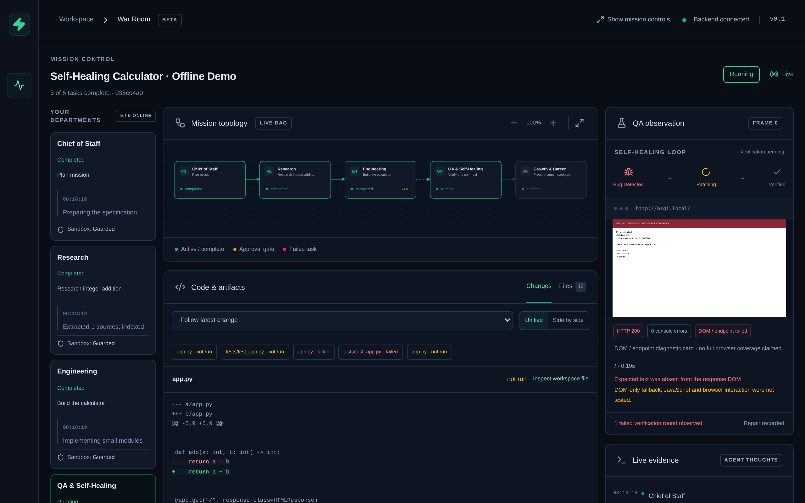
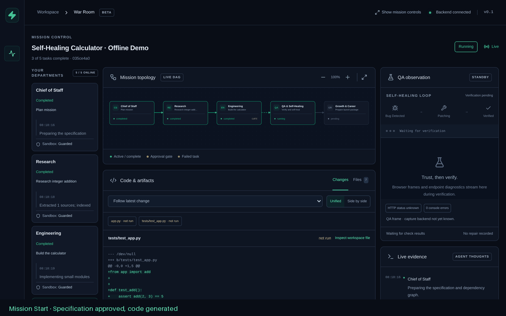

# Backend implementation guide

[Back to OpenFoundry](../README.md) · [Contributor workflow](../CONTRIBUTING.md)

The Python backend foundation for an autonomous AI company and self-healing software studio.
This implementation provides configuration, mission persistence, durable LLM accounting,
provider routing, War Room events, guarded mission workspaces, persistent shared memory,
a plugin registry, DAG orchestration, durable approvals, and a runnable FastAPI/WebSocket
server. The Chief of Staff produces validated plans and shared specifications; the researcher
extracts live web evidence and documents. Engineering commits modular source and tests;
QA executes verification and coordinates bounded, metered repairs. Growth prepares launch
documentation, architecture diagrams, social copy, or tailored career and outreach drafts.
The React War Room streams live tasks, approvals, diagnostics, diffs, artifacts, and costs.
External publication remains separate work.

Requires Python 3.11+. Install and start from the repository root:

```bash
python -m venv .venv
. .venv/bin/activate
python -m pip install -e '.[dev]'
openfoundry --host 127.0.0.1 --port 8000
```

`GET /health` checks database connectivity. Startup creates the SQLite schema and local
data directories; no provider credential is required to start the backend. Executing a
mission requires a configured provider key or Ollama endpoint. Missing configuration is
reported as a failed planning task, with its error visible in mission details and events.

With uv, install the checked-in dependency resolution using `uv sync --frozen --extra dev`
and run `uv run --frozen openfoundry`.

Start the War Room in a second terminal with `cd frontend`, `npm ci`, and `npm run dev`
(Node 22.12+), then open **http://127.0.0.1:5173**. The **Run Self-Healing Demo (No API Key)**
button runs the real five-department workflow with offline provider/research fixtures,
one seeded bug, a human engineering approval checkpoint, one repair, and verified output.
Its API-token cost is zero and no Ollama server is required. See
[frontend/README.md](../frontend/README.md) for authentication, configuration, and verification.

For a single production process, run `npm run build` in `frontend/`, then start
**`uv run --frozen openfoundry`** from the repository root. FastAPI serves the built War Room
at **http://127.0.0.1:8000**, alongside the API and WebSocket server. It mounts the SPA only
when `frontend/dist/index.html` exists; restart after building. API/WS misses and missing
assets remain errors. The responsive three-column UI includes live department cards,
measured sandbox capabilities, structured HTTP/DOM evidence, a self-healing indicator,
unified/side-by-side diffs, file inspection, and specification review with approval/rejection.

Configuration is loaded explicitly with `Settings.from_env()`. The process environment
is the source of truth; `.env` files are not automatically loaded. Supply real credentials
through your process supervisor or secret manager. Never commit them.

| Environment variable | Default / purpose |
| --- | --- |
| `OPENFOUNDRY_HOME` | `.openfoundry` under the current working directory |
| `DATABASE_URL` | `sqlite+aiosqlite` database under `OPENFOUNDRY_HOME` |
| `MAX_MISSION_COST_USD` | `2.00`; positive USD with up to nine decimal places |
| `OPENAI_API_KEY` | Enables OpenAI |
| `GEMINI_API_KEY` | Enables Gemini; `GOOGLE_API_KEY` is also accepted |
| `ANTHROPIC_API_KEY` | Enables Anthropic |
| `OLLAMA_BASE_URL` | Enables Ollama, e.g. `http://127.0.0.1:11434` |
| `OPENFOUNDRY_PROVIDER_ORDER` | `openai,gemini,anthropic,ollama` |
| `OPENFOUNDRY_OPENAI_MODEL` | `openai/gpt-4o-mini` |
| `OPENFOUNDRY_GEMINI_MODEL` | `gemini/gemini-3.5-flash-lite` |
| `OPENFOUNDRY_ANTHROPIC_MODEL` | `anthropic/claude-haiku-4-5` |
| `OPENFOUNDRY_OLLAMA_MODEL` | `ollama_chat/llama3.2` |
| `OPENFOUNDRY_MAX_OUTPUT_TOKENS` | `4096`; per-request upper bound |
| `OPENFOUNDRY_PROVIDER_MAX_ATTEMPTS` | `3`; shared limit for overload and invalid-output retries |
| `OPENFOUNDRY_PROVIDER_RETRY_DELAY_SECONDS` | `1`; exponential delay, capped at 30 seconds |
| `OPENFOUNDRY_REQUEST_TIMEOUT_SECONDS` | `180` |
| `OPENFOUNDRY_SQLITE_BUSY_TIMEOUT_MS` | `30000` |
| `OPENFOUNDRY_API_TOKEN` | Optional for loopback; required for non-loopback CLI binding |
| `OPENFOUNDRY_CORS_ORIGINS` | `http://localhost:5173,http://127.0.0.1:5173` |
| `OPENFOUNDRY_DEPARTMENT_PLUGINS` | Comma-separated trusted Python module names |
| `OPENFOUNDRY_MAX_PARALLEL_TASKS` | `4` per mission |
| `OPENFOUNDRY_DEPARTMENT_TIMEOUT_SECONDS` | `600` per plugin invocation |
| `OPENFOUNDRY_SANDBOX_MODE` | `auto`; `strict` requires Bubblewrap; `guarded` selects host execution |

Ollama must already be serving the configured model. Run one active mission coordinator
per SQLite file; the application enforces this with a
local lock. SQLite WAL supports local concurrent transactions, not multiple active
coordinators, shared network filesystems, or multi-host deployments.

Create a mission and request structured output from Python:

```python
import asyncio

from backend.app.config import Settings
from backend.app.core.llm_router import ChatMessage, LLMRouter
from backend.app.database import Database
from backend.app.models.mission import Mission


async def main() -> None:
    settings = Settings.from_env()
    async with Database(settings) as database:
        async with database.session() as session:
            mission = Mission(title="Product specification", goal="Define a useful notes app")
            session.add(mission)
            await session.flush()
            mission_id = mission.id

        router = LLMRouter(settings, database)
        result = await router.complete(
            mission_id,
            [ChatMessage(role="user", content="Propose a concise product name for a notes app.")],
            json_schema={
                "type": "object",
                "properties": {"name": {"type": "string"}},
                "required": ["name"],
                "additionalProperties": False,
            },
        )
        print(result.structured_output)
        print(await router.budget(mission_id))


asyncio.run(main())
```

For user-supplied keys, construct a separate `Settings` and `LLMRouter` for that user.
Keys are passed per call and are never stored in the database or assigned to LiteLLM
global settings. Protect any future BYOK HTTP endpoint with authentication, TLS, and
mission ownership checks before exposing it publicly.

Budget enforcement uses atomic database reservations, integer nanodollar storage, and a
durable `llm_attempts` ledger. Each paid attempt reserves the model's entire published input
window plus its bounded output at the highest catalog token rate. This is conservative:
a small prompt can be rejected when its full-window reservation exceeds the remaining
budget. Unknown paid model prices fail closed; a configured Ollama route can still run.
Actual usage settles each successful request, including invalid structured responses.
Definitive request rejections release their reservations. Ambiguous failures, cancellation,
and process crashes retain reservations because the provider may have billed the request.
Reconcile those ledger entries against provider billing before releasing any reservation;
there is deliberately no automatic expiry or blind retry of an ambiguous request.

Cost values are estimates using LiteLLM catalog prices. Provider price changes and usage
that exceeds published model bounds cannot be prevented locally; such overruns are recorded
and raise `AccountingError`. Use provider-side spend limits as an additional billing control.
Ollama API-token cost is recorded as zero; infrastructure and electricity costs are excluded.
Automatic SDK retries and implicit fallbacks are disabled, and every explicit fallback
gets its own reservation. Explicit 429/503 responses can retry up to the configured
attempt limit with exponential delays; every physical call gets a new reservation and
ambiguous reservations remain held. Retry-After hints longer than 30 seconds stop the
request for a later retry. Timeouts are not automatically replayed. Safety refusals stop routing.

Structured output uses JSON Schema Draft 2020-12 and is validated locally, rejecting duplicate
keys, non-finite numbers, truncated output, and schema violations. Only local schema references
are accepted. Gemini uses JSON mode with the complete schema in its instructions because
its native schema endpoint rejects some application schemas. Other providers receive
native JSON Schema requests. Every response passes the same complete local validator;
incompatible output is rejected and any reported usage remains charged in the ledger.
Invalid structured output can request a corrected response within the same per-provider
attempt limit; it never bypasses schema or application validation. Engineering makes a
second metered call to review its uncommitted draft against the specification, including
test expectations and boundary cases. This is static model review, not execution evidence;
it cannot change the draft verification plan. Actual QA runs after files are committed,
and its repairs cannot change existing tests. Safe import cleanup and formatting run
before the Engineer first commits generated Python files.

Document parsing retains byte limits, parent deadlines and offline network restrictions.
Linux additionally enforces an address-space cap. macOS reports that this cap is unavailable;
its worker retains CPU/file-size limits. Use Linux isolation for untrusted documents that
require a hard memory boundary.

Workspace path helpers reject traversal and existing symlink escapes. They are path
validation utilities; execute untrusted generated programs inside an OS/container sandbox.
Database initialization creates tables for new installations. Introduce explicit migrations
when changing a deployed schema; `create_all` does not upgrade existing tables.

Run the regression suite and static checks:

```bash
pytest
mypy
ruff check backend
ruff format --check backend
```

Tests use temporary SQLite databases and mocked provider responses, including the actual
LiteLLM OpenAI adapter over mocked HTTP. They do not require keys or incur provider charges.

The backend spine exposes discriminated Pydantic event types in
`backend/app/models/events.py`: `agent_thought`, `task_status_change`, `browser_frame`,
`code_diff`, `approval_request`, `approval_decision`, and `mission_status_change`.
Each includes a UUID event ID, mission ID, aware UTC timestamp, schema version, and an
assigned sequence number after persistence. Serialize with `event.model_dump_json()` and validate with
`parse_event(payload)`. Browser frames accept bounded PNG/JPEG/WebP base64 payloads and
HTTP(S) URLs or `about:blank`. Diffs carry a typed `TestResult`.

`WorkspaceSandbox` defaults to `./workspaces/{mission_id}`. Pass `root=settings.workspace_root`
to use the central application data directory. Use `async with` to release resources.
Linux uses pinned directory descriptors, including `/proc/self/fd` for commands. Other
POSIX hosts retain descriptor-based file operations; Windows uses portable path guards.
Portable checks reject reparse points and root replacement but have weaker resistance to
concurrent path replacement than descriptor-relative Linux operations. File reads and atomic writes reject
absolute paths, `..`, noncanonical paths, symlinks, hard links, special files, and `.git`
metadata. Existing mission files are retained. Git initialization creates an empty baseline;
branches and unified diffs include subsequent edits and optionally untracked files.
Git hooks, configured filters, external diff programs, signing, and submodule recursion
are disabled for service-owned Git operations. Binary files appear as diff summaries.

Test execution defaults to `sandbox_mode="auto"`. Before executing project code, a
harmless capability probe checks whether Bubblewrap can create the required namespaces
and mounts. Supported Linux hosts use isolation; missing Bubblewrap, blocked user namespaces,
and non-Linux hosts select guarded host subprocesses. `CommandResult.execution_mode` records
`isolated` or `guarded`, and `fallback_reason` explains an automatic downgrade. QA emits a
warning when guarded execution is selected. A failed project command is never replayed on
the host after an isolated attempt.

Use `sandbox_mode="strict"` or `OPENFOUNDRY_SANDBOX_MODE=strict` for workloads that must
fail closed when isolation is unavailable. Bubblewrap mounts system libraries and tool
installations read-only, exposes only the mission as writable, keeps Git metadata read-only,
supplies private temporary storage, removes inherited credentials, and disables networking.
The development cloud host blocks user namespaces: real guarded execution and simulated
isolated selection are tested here; successful isolation requires validation on its target host.

Guarded mode enforces an executable/argument allowlist, contained working paths, link checks,
a sanitized environment, bounded output, and a maximum 60-second command timeout. It still
runs Python tests/npm scripts with the service user's filesystem and network permissions.
It cannot contain arbitrary file/network operations performed by generated code. Use a
dedicated account/container for that trust boundary. `sandbox_mode="guarded"` selects it
explicitly; legacy `allow_host_execution=True` maps to guarded mode. Native Windows/macOS
runners were not available for testing; the portable branches are exercised on Linux.

The runner accepts argument lists: `['pytest', '-q', 'tests']`, `['npm', 'test']`,
`['ruff', 'check', '.']`, or `['flake8', '.']`. Options follow a narrow allowlist; shell
strings, plugin injection, external configuration paths, package installation, and linter
flags that rewrite source are rejected. `npm test` executes the project's test script while
disabling pre/post lifecycle hooks. Install project dependencies before execution. Ruff is a runtime dependency;
Flake8 is included in the `dev` extra, and Node/npm are host prerequisites. The timeout
defaults to 60 seconds and can only be shortened. Output is bounded per stream, and timeout,
cancellation, or output overflow terminates the process group on POSIX and uses a
process-tree termination request on Windows. Guarded execution is not an OS process jail. Inspect `CommandResult` for exit
status, captured output, timeout, and overflow; exit zero alone does not mean tests ran.
Use deployment-level CPU, memory, disk, and process limits for hostile workloads in addition
to this filesystem/network boundary and wall-clock timeout.

`MemoryVault` keeps a separate WAL-mode SQLite database for each mission, outside generated
project directories. Its default root is `.openfoundry/memory`; use `settings.memory_root`
for explicit application configuration. `remember()` stores `MemoryKind.RESEARCH_FINDING`,
`DOCUMENT_CHUNK`, `ARCHITECTURE_DECISION`, or `BUG_REPORT`, with author department, source,
metadata, and timestamps. `store_document_chunks()` atomically stores parsed document text.
`save_spec()` upserts a canonical `SPEC.md` record while preserving its original creation
time. Writing the corresponding project file is a separate sandbox operation.

```python
from uuid import uuid4

from backend.app.config import Settings
from backend.app.core.memory_vault import MemoryKind, MemoryVault
from backend.app.core.workspace_sandbox import WorkspaceSandbox
from backend.app.models.events import AgentThoughtEvent, Department


async def prepare_mission() -> str:
    settings = Settings.from_env()
    mission_id = uuid4()
    memory = MemoryVault(mission_id, storage_root=settings.memory_root)
    specification = await memory.save_spec("# SPEC\nBuild an accessible notes application.")
    async with WorkspaceSandbox(mission_id, root=settings.workspace_root) as workspace:
        await workspace.write_file("SPEC.md", specification.content)
        await workspace.initialize_git()
        await workspace.create_branch("engineering/notes-app")
    await memory.remember(
        MemoryKind.RESEARCH_FINDING,
        "Accessibility",
        "Keyboard navigation must cover every notes workflow.",
        department=Department.RESEARCH,
        source="SPEC.md",
    )
    matches = await memory.search("keyboard accessibility", limit=3)
    return AgentThoughtEvent(
        mission_id=mission_id,
        department=Department.ENGINEERING,
        thought=f"Found {len(matches)} relevant shared memories.",
    ).model_dump_json()
```

Retrieval combines TF-IDF cosine similarity (75%) and distinct keyword coverage (25%),
weights titles twice, normalizes Unicode/case, and omits documents without overlapping
terms. Scores and matched terms accompany each result. Kind/department filters are optional;
the default query searches every department's entries. Every search uses a current committed
snapshot, and ranking runs off the event loop. Mission entry/content limits and document
batches are enforced transactionally across writers. This is lexical retrieval, so synonyms
without shared words do not match. SQLite is intended for local-disk deployments; protect the
memory directory as service-owned storage and use a consistent capacity policy across workers.

The mission service runs one coordinator per local SQLite database. A process lock rejects
a second coordinator, including a second Uvicorn worker. Use `openfoundry` or
`uvicorn backend.app.main:create_app --factory --workers 1`. Do not run replicas against a
network filesystem. Task execution within each mission is concurrent up to its configured
limit; dependencies must complete before a task can start. Independent tasks in a running
batch may finish after a sibling fails, but no further tasks are dispatched after that failure.

The Chief of Staff returns a bounded plan: at most 100 tasks, unique keys, registered
departments, known dependencies, and no cycles. It saves structured `SPEC.md` and `STATE.md`
through the same materialization hook used by the scheduler and upserts the specification
as canonical architectural memory. Each first engineering task requires approval, including
parallel implementation branches. Planning targets `researcher`, `engineer`, `qa_self_healer`,
and `growth_career`; legacy department identifiers remain registered for existing missions.
The scheduler persists deterministic UUID-based TaskNodes, executes ready batches with
`asyncio.gather`, and refreshes `STATE.md` from committed task state at batch boundaries,
approval waits, completion, and failure. Its planning hook can replace an unstarted draft;
started or approved scope cannot be silently revised. SQLite/events are authoritative if a
file or memory write is interrupted; these three stores do not share a distributed transaction.

The researcher extracts evidence from live public web sources and workspace documents.
Engineering produces source files and executable tests on a local branch; growth produces
launch drafts. QA executes tests and endpoint/DOM checks, then coordinates bounded repairs
with the engineer. Local commits and evidence are retained for inspection; no branch is pushed.

When any ready task requires approval, the whole mission waits before dispatching that
batch. All outstanding checkpoint approvals must be granted to continue. Rejection cancels
remaining work; duplicate identical decisions are idempotent, and a conflicting decision
returns HTTP 409. Approvals survive restart. Pending tasks resume from persisted state.
Running tasks interrupted by cancellation, shutdown, or a process crash fail visibly and
are never automatically replayed, because model calls or generated-file writes may already
have happened. Retained LLM reservations remain intact. Inspect the failed mission before
submitting replacement work. Existing missions without orchestration metadata are readable
but are not automatically adopted for execution.

Mission REST endpoints are:

| Method | Path | Behavior |
| --- | --- | --- |
| `POST` | `/api/missions` | Accept `{ "goal": "...", "title": "optional title" }`; return 202 |
| `POST` | `/api/missions/demo` | Start the fixed offline self-healing demo; return 202 |
| `GET` | `/api/runtime` | Authenticated non-secret provider/model availability and budget ceiling |
| `GET` | `/api/missions?limit=50&offset=0` | Paginated missions |
| `GET` | `/api/missions/{mission_id}` | State, tasks, approvals, artifacts, error, and consistent event cursor |
| `POST` | `/api/missions/{mission_id}/tasks/{task_id}/approve` | Grant a pending checkpoint |
| `POST` | `/api/missions/{mission_id}/tasks/{task_id}/reject` | Reject and cancel remaining work |
| `GET` | `/api/missions/{mission_id}/files` | Registered artifact manifest |
| `GET` | `/api/missions/{mission_id}/files/content?path=SPEC.md` | Bounded text or base64 file inspection |
| `GET` | `/api/plugins` | Registered departments, measured sandbox mode and external MCP discovery status |
| `GET` | `/api/blueprints` | Validated blueprint catalog, parameters, suggested configuration and template tasks |

Decision bodies optionally include `{ "reason": "Reviewed the specification" }`.
Live mission creation also accepts optional `configuration` with `provider`, a qualified
`model`, and `budget_usd`. These settings apply only to that mission and cannot increase the
server cost ceiling. Credentials stay in server configuration. Mission details include an
`execution` object with the resolved budget and `live` or `demo` mode. An additive
`mission_execution_profiles` table preserves routing across approval waits and restarts;
existing missions without a profile retain server defaults. Demo calls use an injected local
completion function with normal schema validation and zero-cost ledger rows, plus an
in-process research HTTP transport. They never mutate LiteLLM globals or live routing.
This is a single-operator service: a configured token grants access to all missions.
REST uses `Authorization: Bearer <operator token>`. Without a token, mission endpoints
accept only loopback clients; the CLI refuses non-loopback binding without a token.
Browser origins must match the configured CORS origins or the API's own origin. Use TLS
when exposing the service beyond loopback and keep the operator token in a secret manager.

Connect to `/ws/missions/{mission_id}?after=0` to replay durable events, then follow new ones. Events
are committed atomically with lifecycle and approval changes; per-connection readers fetch
committed rows in sequence order. A disconnected or slow socket does not block task execution.
History is retained across process restarts, without a volatile message queue. Resume with
the last processed sequence number. To build an initial UI snapshot, first GET mission
details, render that state, then connect with `after=last_event_id` from the response.
Transport heartbeat messages have `type: "heartbeat"` and a `cursor`; they are not domain
events and should not be passed to `parse_event`. The only accepted client text control is
`ping`; approvals always use REST. Incoming binary controls are rejected.

For browser WebSockets with an operator token, send protocols
`["openfoundry", "bearer." + operatorToken]`. The server negotiates `openfoundry`; credentials
are not placed in the URL. Non-browser clients may use an Authorization header instead.
Authenticate both the initial REST snapshot and the socket. Use bounded reconnect backoff
and retain the last processed sequence number to avoid replaying already-rendered updates.

Department plugins subclass `BaseDepartment`, provide `name` and `role_description`, and
implement its async `execute_task(task, sandbox, memory, emit_event)` method. Register with
`@register_department`. Load modules with `OPENFOUNDRY_DEPARTMENT_PLUGINS` or publish package
entry points under `openfoundry.departments`; restart the server to discover new plugins.
Optional `capabilities` is a tuple of unique lowercase identifiers, and `plugin_version`
identifies the plugin release. The catalog includes enabled implementations, disabled
registry entries, and legacy identifiers with their canonical replacements. Sandbox status
reports the configured mode, a cached namespace capability probe, and the resulting
`isolated`, `guarded`, or `unavailable` execution mode. Explicit guarded mode skips the
probe and reports isolation availability as unknown. Results are cached for 30 seconds;
the probe uses a temporary workspace and never executes generated mission code.
Names are lowercase identifiers up to 64 characters; custom names are supported in events
and memory. Plugin constructors receive an `LLMRouter`. Results are JSON dictionaries;
`summary` stores a human-readable result and optional `artifacts` contains objects with
`file_path` and `artifact_type`. Declared artifacts must exist inside the mission sandbox.
Emit only mission-scoped thoughts, browser frames, or code diffs. The scheduler owns task,
mission, and approval events. Plugins are trusted backend Python code, must be safe for
concurrent calls, and must cooperate with cancellation; the file sandbox does not isolate
the plugin implementation itself. Use the isolated test runner for untrusted generated code.

The scheduler/API tests use deterministic departments and mocked LLM results. They exercise
real SQLite transactions, real file writes, approval races and restart recovery, WebSocket
replay and reconnect, rapid disconnect cleanup, authentication, and plugin contract checks.

The `growth_career` department reads `SPEC.md`, completed task summaries, registered artifact
contents, and shared memory. Its bounded evidence snapshot includes content hashes and QA
outcomes. Artifact records have no producing-task field, so the snapshot lists registered
artifacts alongside completed task states rather than claiming per-file task provenance.
Credential-like filenames are excluded. Launch mode writes a project `README.md`, an escaped
Mermaid flowchart, and Show HN, Reddit, and X drafts. Career mode writes tailored profile,
portfolio, cover letter, or outreach material and preserves the existing project README.
Packages live in `growth/{task_id}/`, including `sources.json` and `manifest.json` for review.
Sources contain mission context and should be treated as private operator data. All content
is labeled as draft; this plugin does not publish posts or send messages.

`test_phase2_mission.py` drives all five canonical departments through the real API and
orchestrator, approves the engineering checkpoint, observes WebSocket events and replay,
and verifies one failing test/DOM check followed by one repair and successful verification.
Only provider responses and public research HTTP are replaced with deterministic fixtures;
Git, test subprocesses, ASGI probes, artifacts, memory, and the metered cost ledger run normally.


Research tasks accept prose (explicit HTTP URLs, or a public web search if none are supplied)
or a JSON task description:

```json
{
  "query": "Compare embedded full text search approaches",
  "urls": ["https://www.sqlite.org/fts5.html"],
  "documents": ["uploads/requirements.md"],
  "max_sources": 4,
  "prefer_browser": true,
  "prefer_docling": true
}
```

Sources are limited to eight per task. Documents must already exist inside that mission's
workspace; agent input cannot select host files. Explicit sources exceeding `max_sources`
are rejected. Public web extraction uses an async HTTP client and HTML-to-Markdown parser.
It validates redirect destinations and public DNS answers, connects to validated IPs while
retaining Host/TLS identity, and rejects credentials in URLs, private addresses, and ports
other than 80/443. Environment proxies and cookies from other tasks are not used. Search
uses DuckDuckGo HTML results; blocked search or JavaScript-only pages may require explicit
sources or a working browser. Each fetch has a 30-second deadline and a 2 MiB byte limit
(or the smaller configured sandbox file limit). Extracted text is limited to 500,000 characters.

Optional integrations can be installed separately or together:

```bash
uv sync --extra dev --extra browser --extra documents
```

`browser-use` needs a provisioned `chromium`, `chromium-browser`, `google-chrome` or
`chrome` executable on the sanitized worker PATH and OS sandbox support. It never installs
a browser at task execution time. Rendering runs in a fixed-module worker with a sanitized
environment; browser SDK subprocesses cannot inherit backend provider/cloud credentials. The adapter
uses deterministic browser APIs, a fresh profile, and a same-host public-address proxy;
it never invokes browser-use's LLM Agent or bypasses mission billing. Extensions, cloud
browsers, proxy bypass for loopback, and non-proxied WebRTC/QUIC are disabled. Cross-host
resources are blocked, so some pages will render incompletely. Launch or rendering failures
fall back to the fetched HTML and emit a typed warning. Containers where the library would
launch Chromium with `--no-sandbox` use the HTTP fallback instead.

Docling uses its model-free native PDF pipeline, with no OCR model download. Missing or
unsuccessful conversion falls back to UTF-8 text/Markdown/JSON/CSV/HTML or `pypdf`. Encrypted,
corrupt, over-100-page, or image-only PDFs fail explicitly; scanned documents need a separate
OCR integration. Parser subprocesses run with isolated Python startup (`-I`), reject inherited `PYTHONPATH`,
and use the same positive environment allowlist as agent test commands. They run offline,
receive no provider credentials, and have
30-second wall, 20-second CPU, 1.5 GiB address-space, and bounded output limits. Timeout or
cancellation kills and reaps the child. These limits constrain parsing; the subprocess is
not an OS security boundary for hostile native parser exploits.

Research artifacts live under `research/{task_id}/`: original bytes, extracted Markdown,
structured document JSON, rendered HTML when available, a report, and a manifest containing
source URLs, hashes, extraction backends, timestamps, and unavailable-source diagnostics.
Evidence chunks and cited findings are indexed in the mission's shared memory. Reports do
not assert independent verification of source claims. A partial source failure is visible;
if every source fails, the task fails after saving diagnostics. Source URLs and content may
contain sensitive data, so workspace/artifact access follows the existing operator-token policy.

`uv run pytest` covers both real departments through the scheduler and approval flow, real
text/PDF parsing subprocesses, HTTP source preservation, public-network boundary checks,
optional integration contracts, parallel research, mission isolation, and timeout/cancellation
cleanup. Optional browser-use and Docling contracts use test doubles; the default regression
suite requires neither downloaded browser binaries nor model weights or paid provider calls.


Engineering reads `SPEC.md`, retrieves mission memory and current source, and requests a
structured deliverable through the budgeted `LLMRouter`. All model-generated files contain
fewer than 200 lines, paths are validated before writing, and Python files are syntax-checked.
The service creates a task branch, commits only declared files, and emits per-file unified
diffs with `not_run` verification status. It preserves unrelated staged files and disables
Git hooks/filters. Commit manifests under `engineering/` record branch, commit, paths, and
diffs. No dependency installation, shell command, Git remote, or publication occurs.

The engineer writes `openfoundry.qa.json`; QA also accepts this schema directly as its
JSON task description. Prose QA tasks load the existing file, or use pytest/Ruff defaults:

```json
{
  "commands": [
    {"command": ["pytest", "-q", "tests"], "cwd": "."},
    {"command": ["ruff", "check", "."], "cwd": "."}
  ],
  "asgi_app": "app:app",
  "app_factory": false,
  "base_url": null,
  "probes": [
    {"path": "/", "expected_status": 200, "contains": "Ready", "selectors": ["h1"]}
  ],
  "prefer_browser": true,
  "max_repairs": 3
}
```

An HTTP origin may replace `asgi_app`; explicit loopback origins support local test servers,
public hostnames must resolve exclusively to public addresses, and DNS connections are
pinned. Credentials, LAN/metadata addresses, redirects, and cross-origin probe paths are
rejected. Strict Bubblewrap networking prevents probes reaching host/external services;
ASGI transport is the recommended option in that mode. Generated ASGI applications run
in a separate allowlisted pytest worker with startup/shutdown lifespan handling. They are
never imported into the backend API process. Libraries without endpoint probes report
browser verification as skipped.

When available, Playwright or browser-use renders the fetched response in a fresh sandboxed
headless browser, captures a PNG and console errors, and validates the resulting DOM.
Network access and external page resources are blocked during this offline render. This
checks response DOM/inline JavaScript; it does not verify a complete frontend bundle,
cross-page interaction, or external resources. Missing browser runtimes fall back to HTTP/ASGI
response and DOM checks. Fallback `BrowserFrameEvent` images are visibly labeled diagnostic
cards, not browser screenshots. Install optional adapters with `uv sync --extra playwright`
or `uv sync --extra browser`, and provision a compatible Chromium separately. No browser
Agent makes unmetered LLM calls.

A failed round produces metered structured root-cause hypotheses, saved bug reports and
shared bug memory. `Engineer.apply_bug_fix()` commits a proposed patch without claiming it
passed. QA reruns the same verification plan and emits diffs with actual check outcomes.
There is one initial verification plus at most three repairs/reverification rounds. Existing
tests, specifications and verification configuration cannot be edited by repair output;
QA hashes and checks acceptance files for mutation. New regression test files may be added.
Unchanged patches, exhausted budget, invalid patches, and changed acceptance evidence stop
the loop. Final failure stays failed, with diagnostic artifacts registered by the scheduler.
These checks guard against accidental weakening; they are not proof against deliberately
malicious generated programs forging test results in guarded mode.

Per-round checks, probe reports, frames and bug reports live under `qa/{task_id}/`.
Backend-authored worker files live under `.openfoundry-qa/` and are excluded from project
lint/discovery; they are tool infrastructure rather than generated application modules.
Test commands use a fresh bytecode-cache lookup so same-size, same-second patches cannot
reuse stale `.pyc` code. Pytest explicitly loads the bundled async plugin and uses only
contained `.`/`src` import roots; arbitrary installed plugins remain disabled. Pytest selects
configuration inside the command's mission directory and excludes ancestor service
configuration, so container workspaces use their own test discovery and imports.
QA invocation deadlines still apply across the entire plugin;
raise `OPENFOUNDRY_DEPARTMENT_TIMEOUT_SECONDS` when real suites need multiple 60-second
runs and repair calls. Cancellation terminates active commands and is never reported as a pass.

The deterministic regression suite exercises the real Engineer → pytest/DOM failure →
committed auto-patch → pytest/Ruff/DOM pass workflow, exact retry limits, preserved tests,
failed-task artifacts, and loopback HTTP probing. Browser integrations use contract doubles;
actual Chromium execution remains dependent on the target host's installed runtime/sandbox.
On Unix, document parser CPU/address-space limits remain enabled; Windows retains wall-time
and output limits without Unix `resource` limits.

The Phase 4 integrations include [MCP tools for terminal/editor clients](mcp.md),
validated mission [blueprints](../blueprints/), Docker/Compose deployment, CI, and captured
visual demo assets. The command bar loads `/api/blueprints`; selection fills the goal,
editable parameters, suggested routing/budget and task preview. Submission preserves the
chosen template and resolved parameters in the execution profile, and supplies its DAG,
deliverables and acceptance criteria to the existing Chief of Staff planning hook. The
Chief of Staff adapts the template and the scheduler validates the resulting DAG normally.





These are real Chromium captures of the key-free demo, including an actual failed check,
local engineering patch and verified pass. The capture uses Focus War Room mode at
1280×800; the hero is saved at 2× resolution. The demo's provider responses and public
research source are deterministic fixtures; department execution, Git, tests and endpoint
checks are real. Frames remain labeled as DOM diagnostics when a full browser is unavailable.

Build and launch with Docker Compose:

```bash
export OPENFOUNDRY_API_TOKEN="$(openssl rand -hex 32)"
docker compose up --build -d
```

Open http://127.0.0.1:8000 and enter that operator token. Compose requires a token because
the service listens on all container interfaces; the published host port is loopback only.
Provider keys are optional environment passthrough, and the demo requires none. The image
runs as UID 10001, uses frozen uv dependencies, includes Git/Node/npm and serves the unified
API/SPA. Named volumes `foundry_data` and `workspaces` persist SQLite/shared memory and
`/app/workspaces` (`./workspaces` inside the app) respectively. Keep both volumes for recovery;
`docker compose down` preserves them. The healthcheck calls `/health`. Set
`OPENFOUNDRY_WORKSPACE_ROOT` for an alternative local workspace location. Host Ollama must
be reachable from the container; `localhost` inside a container refers to that container.

Regenerate the screenshots and GIF after installing frontend dependencies and Chromium:

```bash
uv run --frozen python scripts/generate_demo_assets.py
```

Use `--skip-build` with an existing frontend build and
`PLAYWRIGHT_CHROMIUM_EXECUTABLE=/usr/bin/chromium` for a system browser. The generator
uses a temporary database and operator token, clears provider/MCP configuration, starts a
local API, captures all four phases, verifies completion at zero API cost, and shuts it down.
`OPENFOUNDRY_DEMO_STEP_DELAY_SECONDS` controls only offline completion pacing (0–5 seconds;
default 0.15), allowing transient failure/patch states to be observed without fabricating UI
state. GitHub Actions runs backend checks and frontend/build/Chromium verification on pushes
and pull requests to main, and uploads regenerated visual/browser artifacts for review.


Publication security checks are documented in [SECURITY_AUDIT.md](SECURITY_AUDIT.md).
The CLI and application install credential redaction before standard Python log handlers,
including access/WebSocket/SDK messages and exception text. Request validation errors omit
submitted input/context values to avoid echoing an accidentally supplied credential.
These controls do not turn guarded execution or trusted Python plugins into an OS jail.

## Live synthetic evaluation, 19 October 2026

The final batch on source commit `0bbea0d9e88fc430fb29d9d8aa81723436c22d2f`
used real Gemini 3.5 Flash-Lite calls from the OpenFoundry free-tier project, fresh
workspaces and no response cache. All six missions completed and passed independent
checks inserted only after each mission finished. The grader copied only `app.py` into
a new workspace, excluding generated test configuration.

| Utility | Fresh missions passed | Independent checks passed | Live QA repairs |
| --- | --- | --- | --- |
| Unicode slug generation | 2/2 | 24 | 0 |
| Decimal invoice totals | 2/2 | 26 | 2 |
| CSV category aggregation | 2/2 | 26 | 1 |

All three observed live repairs addressed lint findings; this batch did not demonstrate
repairing a failing functional test. The separate regression suite passed 436 tests,
with two Linux-only Bubblewrap checks skipped on macOS. Ruff, formatting, Flake8 and
strict application typing checks also passed.

The [evidence receipt](evidence/live-validation-2026-10-19.json) contains the full
development history (33 missions, including 20 unsuccessful end-to-end attempts),
source fingerprints, generated source, QA histories, token ledgers, fixed independent
checks and negative harness controls. The initial failed baseline is also retained in
[its original receipt](evidence/live-pilot-2026-10-19.json).

This is a small synthetic integration pilot following fixes informed by earlier failures.
It does not establish production reliability or measured token savings. Research analyzed
local requirements; this pilot did not exercise live web research, browser-based web apps
or deployment. Execution used guarded macOS processes. The final batch's catalog estimate
was approximately $0.155; actual invoice charges were not retrieved. AI Studio showed
Free tier with billing unset, and no alternate provider accounts were needed.

Reproduce with a securely supplied `GEMINI_API_KEY` and
`uv run --frozen python -m scripts.run_live_evaluation --case all --repeats 2`.
Credentials must remain outside source and command arguments. Results are written under
the ignored `.openfoundry/live-evaluations` directory for review before publication.
